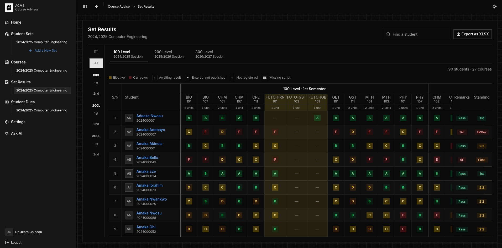
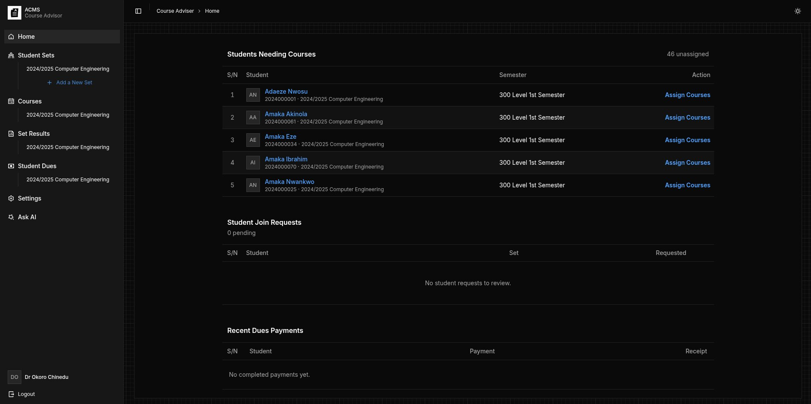
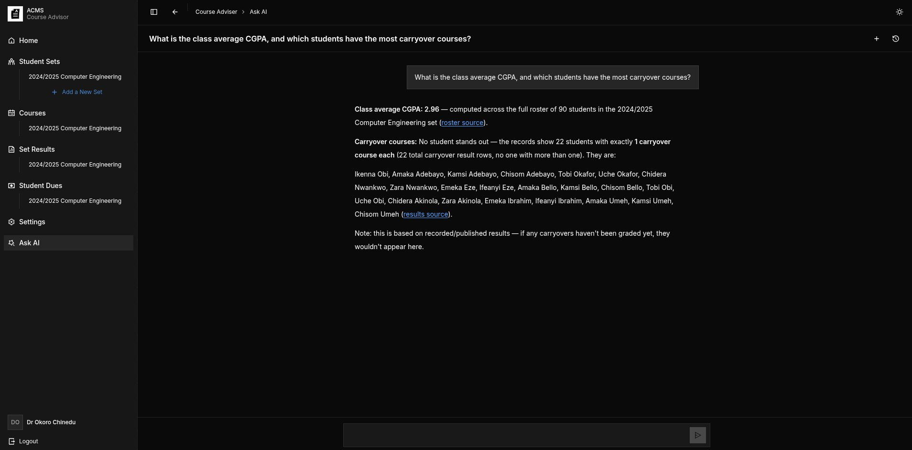
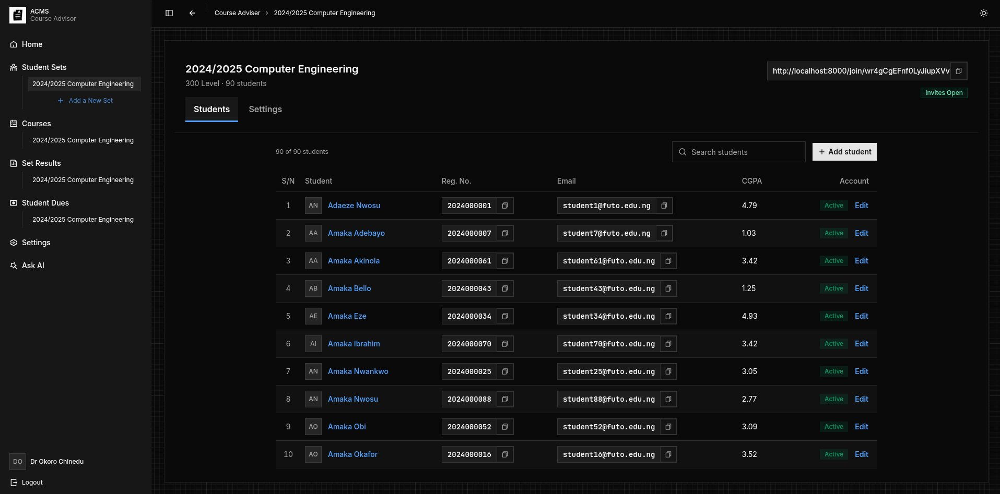
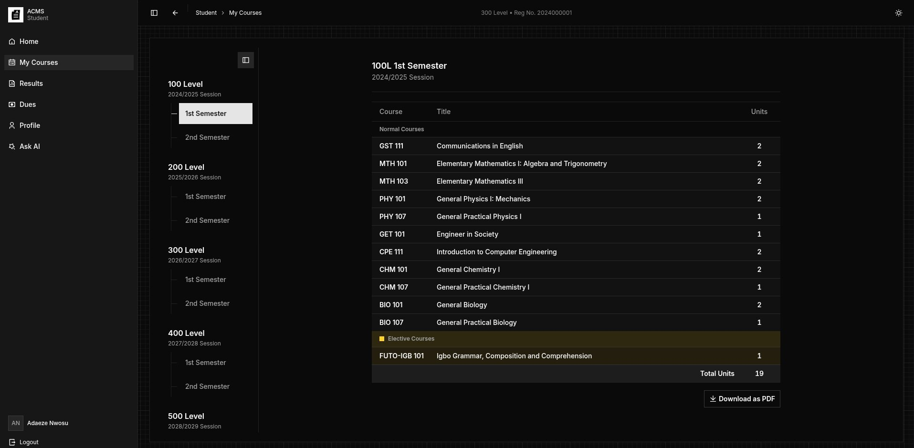
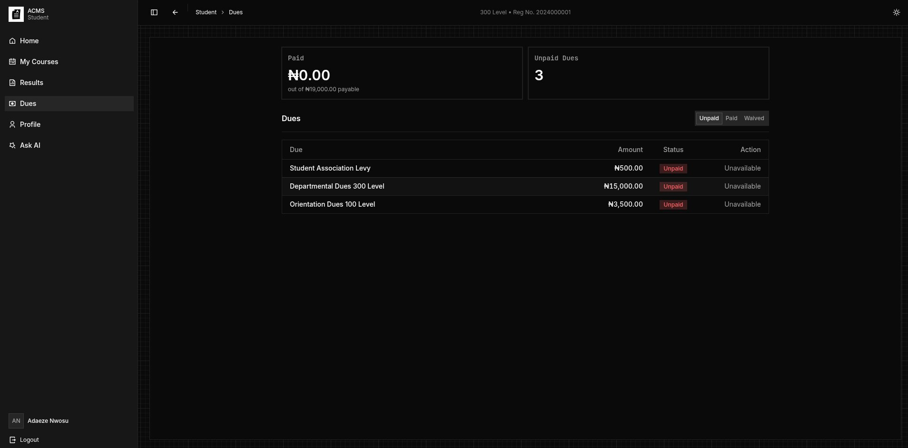
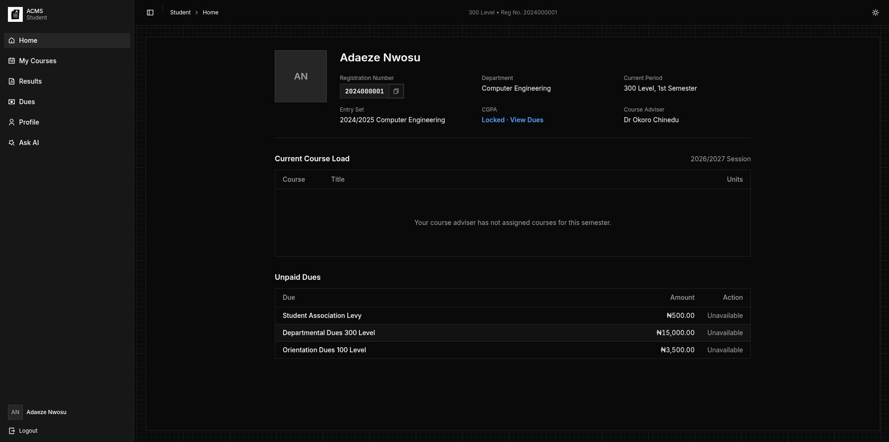
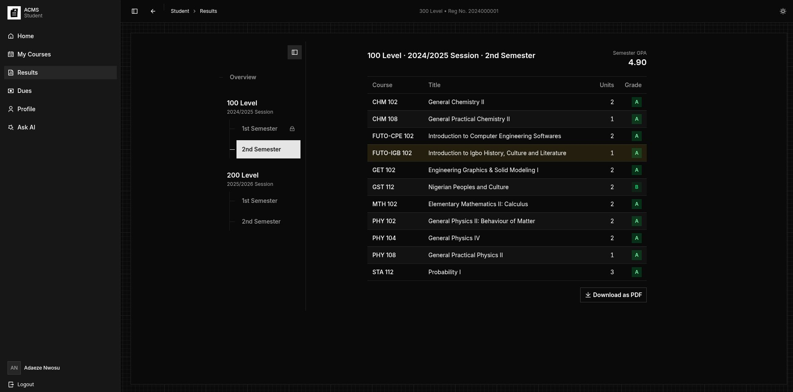

# ACMS

ACMS (Automated Course Management System) helps a course adviser manage student sets, course assignments, results, and dues. Students use their dashboard to view their assigned courses, published results, and payments.



Built with Laravel 13, Inertia 3, React, and PostgreSQL.

## Local setup

Use PHP 8.5, Composer, Node.js/npm, and PostgreSQL. The locked dependencies require at least PHP 8.4.1; PHP needs the PostgreSQL, GD, DOM, and ZIP extensions.

Follow the instructions [here to install Laravel PHP framework](https://laravel.com/framework/docs/installation).

Create a PostgreSQL database and user, then copy `.env.example` to `.env`. Set `DB_*` to your local database and use `MAIL_MAILER=log` for local email.

```bash
cp .env.example .env
composer install
npm install
php artisan key:generate --no-interaction
php artisan migrate --no-interaction
composer run dev
```

`composer run dev` starts the web server, Vite, logs, and the default queue listener. In another terminal, process email jobs when testing invitations or password resets:

```bash
php artisan queue:work database --queue=emails --tries=1
```

To load **development-only** sample data, run `php artisan db:seed --no-interaction`. The seeded adviser is `staff1@futo.edu.ng`; a seeded student is `student1@futo.edu.ng`. Both use `password`.

## How it works

1. An adviser creates a student set and its academic sessions, then adds students to the reference roster. Students claim their roster record through the set's invite link and verify their email.
2. The adviser maintains the set's course catalog and semester offerings, assigns courses to students, enters grades, and publishes results by course. Students view their assigned courses and released results.
3. The adviser creates dues and connects a Paystack payout account. Students pay from their dashboard; successful payments produce downloadable receipts. Both roles can ask read-only questions about records they are allowed to see.

## Screenshots

**Student Adviser – Home Dashboard**



**Student Adviser – AI Assistant**



**Student Adviser – Set Results**


**Student Adviser – Student Set Overview**


**Student – Courses**


**Student – Dues**



**Student – Home Dashboard**


**Student – Results**


## Integrations and checks

- Resend delivers verification and receipt email; see [email setup](workflows/resend-email.md).
- Paystack handles dues and adviser payouts; see [dues setup](workflows/paystack-dues.md).
- OpenRouter powers Ask AI through the Laravel AI SDK; set `OPENROUTER_API_KEY` to enable it.
- Cloudflare R2 is optional for deployed file storage; local disks work for development. See [R2 setup](workflows/cloudflare-r2.md).
- Run `composer run ci:check` for formatting, types, and PHP tests. Tests use an in-memory SQLite database.

In deployment, set `APP_DEBUG=false`, build assets with `npm run build`, and run a persistent worker for the `default` and `emails` queues. Configure the services you intend to use through environment variables; never commit credentials.
